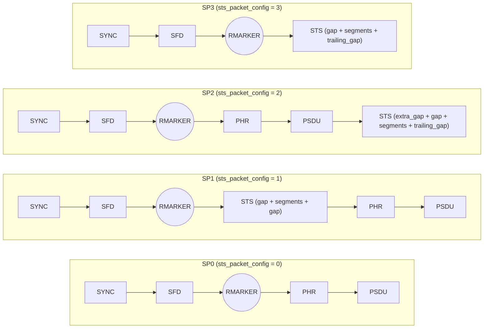

# Frame Structure & STS

IEEE Std 802.15.4-2024 defines four HRP UWB PPDU layouts controlled by `HRPConfig.sts_packet_config` (`0..3`, Figures 16-1, 16-3, and 16-9 through 16-12).

## STS Packet Configurations (`SP0`–`SP3`)



## Chip-Level Field Indexing (`HRPFieldIndices`)

Use [field_indices][uwb_hrp.field_indices] (or `result.indices` from [generate_waveform][uwb_hrp.generate_waveform]) to inspect exact 0-based chip slices and ranging marker offsets without having to compute symbol lengths manually:

```python
from uwb_hrp import HRPConfig, field_indices

cfg = HRPConfig(
    mode="HPRF",
    channel=9,
    code_index=25,
    preamble_duration=64,
    sfd_number=2,
    psdu_length=20,
    sts_packet_config=2,
    num_sts_segments=2,
    sts_segment_length=64,
    extra_sts_gap=4,
)

idx = field_indices(cfg)
print("RMARKER chip  :", idx.rmarker_chip)
print("SRMARKER chips:", idx.srmarker_chips)
print("Total chips   :", idx.total_chips)
print("1-based ranges:", idx.to_1based_ranges())
```

- **`rmarker_chip`:** Always the first chip immediately following the SFD (`idx.sfd.stop`) across all packet configurations (Figure 16-3).
- **`srmarker_chips`:** Tuple of `num_sts_segments + 1` chip offsets locating the STS ranging markers around active STS segments.
- **`to_1based_ranges()`:** Returns 1-based inclusive `(start, end)` intervals matching the format of IEEE `packet_info.txt`.

## SP2 Extra STS Gap & Trailing Gap Nuance

### `extra_sts_gap` and `extra_sts_gap_index`
In `SP2` frames (`sts_packet_config=2`), an optional extra silent interval of `extra_sts_gap * 4` chips (`extra_sts_gap` in `0..127`, Table 16-19) is inserted immediately between the PSDU and the leading 512-chip STS gap. In `HPRF` mode with `psdu_size_extension == 0`, you may also set `extra_sts_gap_index` (`0..3`) to populate PHR bits `A1`/`A0`.

### `sts_trailing_gap` (IEEE 802.15.4-2024 vs. Draft D08)
Per IEEE Std 802.15.4-2024 Figures 16-10 and 16-12, `SP2` and `SP3` frames include a **512-chip silent gap** after the final active STS segment (`sts_trailing_gap=True`, the default).

!!! note "Reproducing IEEE P802.15.4z Draft D08 test vectors"
    The public IEEE P802.15-20-0002-01-004z test vectors (April 2020, Draft D08) omitted this trailing 512-chip silent gap on `SP2`/`SP3` frames. Set `sts_trailing_gap=False` when comparing chip-for-chip against Draft D08 vectors.

## AES-128 CTR DRBG & Counter Advancement

Per Section 16.2.9.2 and Annex G, active STS pulses are driven by an AES-128 CTR-mode DRBG seeded by a 16-byte `sts_key` and 16-byte `sts_v = VUpper96 || VCounter`:

- Each 128-bit AES block yields 128 MSB-first bits mapped to BPSK pulse polarities (`0 -> +1`, `1 -> -1`) spread by `delta_L = 8` (BPRF) or `delta_L = 4` (HPRF).
- The lower 32-bit big-endian `VCounter` increments modulo \(2^{32}\) per 128-bit block while `VUpper96` stays constant.
- [generate_chips][uwb_hrp.generate_chips] and [generate_waveform][uwb_hrp.generate_waveform] advance `VCounter` automatically across packets when `advance_sts_counter=True` (default), and expose the next 16-byte seed via `result.next_sts_v`.
